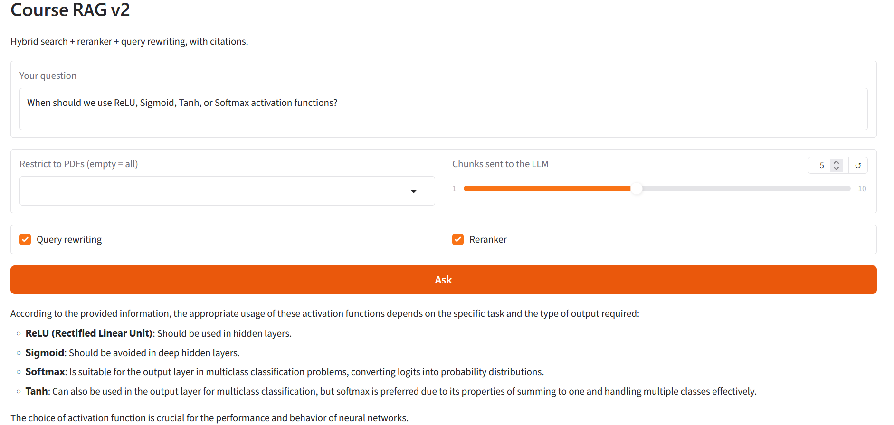

# 📚 RAG Implementations — Basic & Advanced


A practical implementation of **Retrieval-Augmented Generation (RAG)**, exploring two approaches to building PDF-based question-answering systems: a basic retrieval pipeline and an advanced hybrid retrieval pipeline.

The project demonstrates how document processing, semantic search, information retrieval, reranking, and Large Language Models (LLMs) can work together to generate context-aware answers from user-provided documents.

---

## 🎯 1. Project Overview

Large Language Models can generate impressive responses, but they may produce inaccurate information or lack access to specific documents.

**Retrieval-Augmented Generation (RAG)** addresses this limitation by retrieving relevant information from an external knowledge source and providing it as context to an LLM before generating an answer.

This project explores two implementations:

- 🟢 **Basic RAG:** A straightforward pipeline based on PDF extraction, text chunking, dense embeddings, and FAISS similarity search.
- 🔵 **Advanced RAG:** An enhanced pipeline combining layout-aware document processing, hybrid retrieval, Reciprocal Rank Fusion, query rewriting, and cross-encoder reranking.

Both implementations use Qwen2.5-3B-Instruct for answer generation.

## 🏗️ 2. System Architecture

The two implementations follow the same general RAG workflow, with different approaches to document processing and retrieval.

### 🟢 Basic RAG Pipeline

1. 📄 **Document Loading:** Extract text from PDF documents using PyMuPDF.
2. ✂️ **Text Chunking:** Divide extracted text into smaller, manageable chunks.
3. 🧠 **Embedding Generation:** Convert chunks into vector representations using Sentence Transformers.
4. 🔎 **Vector Retrieval:** Use FAISS to retrieve semantically relevant chunks.
5. 🤖 **Answer Generation:** Provide the retrieved context to Qwen2.5-3B-Instruct to generate an answer.
6. 💬 **User Interface:** Interact with the system through a Gradio interface.

### 🔵 Advanced RAG Pipeline

1. 📄 **Document Processing:** Extract structured content using PyMuPDF4LLM, with Tesseract OCR as a fallback for image-based content.
2. ✂️ **Intelligent Chunking:** Apply heading-aware chunking to preserve document structure.
3. 🧠 **Embedding Generation:** Generate embeddings using BAAI/bge-base-en-v1.5.
4. 🔍 **Hybrid Retrieval:** Combine dense vector retrieval through FAISS with keyword-based retrieval using BM25.
5. 🔀 **Reciprocal Rank Fusion:** Combine retrieval rankings into a unified result list.
6. 🎯 **Reranking:** Use BAAI/bge-reranker-base to improve the relevance of retrieved passages.
7. 🔄 **Query Rewriting:** Use Qwen2.5-3B-Instruct to reformulate queries when needed.
8. 🤖 **Answer Generation:** Generate context-aware answers using the retrieved information.
9. 📊 **Evaluation:** Include an evaluation component with sample questions and retrieval/answer assessment metrics.
10. 💬 **User Interface:** Provide an interactive Gradio interface.

---

## 🟢 3. Basic RAG Implementation

The basic implementation focuses on the essential components of a RAG system.

**Main components:**
- PDF text extraction with PyMuPDF.
- Fixed-size text chunking.
- Multilingual MiniLM embeddings.
- FAISS dense vector retrieval.
- Qwen2.5-3B-Instruct for answer generation.
- Gradio interface.

**Embedding model:** `sentence-transformers/paraphrase-multilingual-MiniLM-L12-v2`

**Language model:** `Qwen/Qwen2.5-3B-Instruct`

### 📸 Basic RAG — Interface Demonstration


---

## 🔵 4. Advanced RAG Implementation

The advanced implementation introduces additional retrieval and document-processing techniques to improve the quality and relevance of retrieved context.

**Main components:**
- Layout-aware PDF extraction with PyMuPDF4LLM.
- OCR fallback using Tesseract.
- Heading-aware text chunking.
- BGE embeddings.
- Hybrid retrieval using FAISS and BM25.
- Reciprocal Rank Fusion (RRF).
- Cross-encoder reranking.
- Query rewriting.
- Evaluation metrics.
- Gradio interface.

**Embedding model:** `BAAI/bge-base-en-v1.5`

**Reranker model:** `BAAI/bge-reranker-base`

**Language model:** `Qwen/Qwen2.5-3B-Instruct`

### 📸 Advanced RAG — Interface Demonstration



---

## 📚 5. Knowledge Base & Demonstration Dataset

Both implementations are designed to work with user-provided PDF documents and are not restricted to a particular subject or domain.

For demonstration and testing purposes, **Deep Learning course materials** were used as the knowledge base.

The documents cover several topics, including:

- 🧠 Artificial Neural Networks (ANNs).
- 🖼️ Convolutional Neural Networks (CNNs).
- ⚡ Activation Functions.
- 🔄 Forward and Backward Propagation.
- 📉 Loss Functions.
- 🔁 Recurrent Neural Networks (RNNs, LSTMs, and GRUs).
- 🧩 Variational Autoencoders (VAEs).

The systems retrieve relevant passages from these documents and use them to generate context-aware answers.

The knowledge base can be replaced with other PDF documents, allowing the same RAG architecture to be applied to different subjects and domains.

---

## 🛠️ 6. Technologies & Dependencies

| Technology | Purpose |
|---|---|
| Python | Main programming language |
| PyMuPDF | PDF text extraction |
| PyMuPDF4LLM | Layout-aware PDF processing |
| Tesseract OCR | Text extraction from images |
| Sentence Transformers | Text embedding generation |
| FAISS | Dense vector similarity search |
| BM25 | Keyword-based retrieval |
| BGE Cross-Encoder | Retrieved passage reranking |
| Hugging Face Transformers | Language model loading and inference |
| Qwen2.5-3B-Instruct | Answer generation and query rewriting |
| Gradio | Interactive user interface |
| NumPy & Pandas | Numerical operations and evaluation |

Separate dependency files are provided for each implementation:

- `requirements-basic.txt`
- `requirements-advanced.txt`

**Additional requirements:**
- PyTorch is required for model inference. Google Colab normally provides it in its runtime.
- Tesseract OCR must also be installed as a system executable for the Advanced implementation.
- A GPU runtime is recommended for practical inference with the selected language models.

---

## 🚀 7. How to Run

The notebooks are designed to run in Google Colab.

### Step 1 — Clone or download the repository

Clone the repository:

```bash
git clone https://github.com/goussasmohamedelhocine-bot/RAG-Implementations.git
```

Alternatively, download the repository as a ZIP file from GitHub.

### Step 2 — Open a notebook

Choose one of the following:

- `Basic-Rag/Basic_RAG.ipynb`
- `Advanced-Rag/Advanced_RAG.ipynb`

Upload the selected notebook to Google Colab or open it directly from your downloaded files.

### Step 3 — Configure the runtime

In Google Colab:

1. Open **Runtime**.
2. Select **Change runtime type**.
3. Choose a GPU accelerator if available.

### Step 4 — Provide PDF documents

Upload your PDF files to the directory expected by the notebook.

For the default configuration, the document directory is:

```text
/content/documents/
```

### Step 5 — Execute the notebook

Run the notebook cells in order.

The notebooks install their required Python packages, process the documents, generate embeddings, build the retrieval components, and load the language model.

### Step 6 — Interact with the system

Launch the Gradio interface, upload or select your documents as configured, and ask questions about their content.

---

## 📁 8. Repository Structure

```text
RAG-Implementations/
│
├── Basic-Rag/
│   └── Basic_RAG.ipynb
│
├── Advanced-Rag/
│   └── Advanced_RAG.ipynb
│
├── requirements-basic.txt
├── requirements-advanced.txt
├── README.md
└── .gitignore
```

---

## 👨‍💻 9. Author

**Mohamed El Hocine Goussas**

AI Engineering Student | Algeria

- GitHub: [@goussasmohamedelhocine-bot](https://github.com/goussasmohamedelhocine-bot)
- LinkedIn: [Mohamed El Hocine Goussas](https://www.linkedin.com/in/goussas-mohamed-el-hocine-71b4153a0/)

---

⭐ If you find this project useful, feel free to explore the implementations and experiment with your own PDF documents.

**Built as a practical exploration of Retrieval-Augmented Generation and modern information retrieval techniques.**
